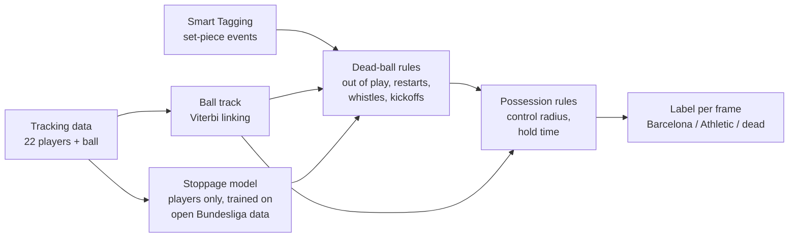

# Barcelona Hackathon: who has the ball?


https://github.com/user-attachments/assets/856faa89-2f5d-4cf2-aaf8-fb9a62d7e3d1


Frame-by-frame ball possession for a full LaLiga match (FC Barcelona vs Athletic Club), worked out
from automatic player and ball tracking data. No video model.

Built for *More than a Hack 2027*, run by Metrica Sports, FC Barcelona and the Mobile World Capital
Barcelona. Each of the match's 199,319 video frames gets one label: Barcelona in possession,
Athletic in possession, or ball dead.

## Why I built it

I entered More than a Hack 2027 because I wanted to work on a real sports-data problem instead of a
clean tutorial dataset: one full professional match, the same automatic tracking a club analyst
would get, and a question that sounds simple until the ball disappears from the data. It was also a
chance to build something end to end under real constraints: a deadline, no labels for the match
itself, and a rules clarification halfway through that forced me to rebuild the pipeline.

▶ [Watch the demo video](media/possession_demo.mp4) (2.5 minutes): the pipeline's label for every
frame, drawn on the tactical camera.

## Results

Scored on the 5 minutes that have official labels. The score was checked once, after the method
was frozen, and nothing was tuned on it.

What the scores mean: frame accuracy is the share of frames with the right label. Spell F1, the
competition's ranking metric, is stricter: it counts a possession as found only if the predicted
spell overlaps the real one enough, averaged over several overlap thresholds. Ending a possession
a few seconds early or late costs points, so values around 0.5 are good on this task.

| | This pipeline | Organisers' best baseline |
|---|---|---|
| Frame accuracy | **86.7%** | 72.7% |
| In-play / dead F1 | **0.971** | 0.899 |
| Macro F1 (Barcelona / Athletic / dead) | **0.867** | 0.581 |
| Possession-spell F1 (the ranking metric) | **0.500** | 0.424 |
| Possessions found (truth: 17) | 19 | 16 |

A caveat: these 5 minutes are easier than the match as a whole. The tracking data is missing the
ball on 11.8% of their frames, against 41.5% across the match, so the full-match score will be
lower. The Bundesliga check below hides the ball on the full-match pattern and is the more
realistic estimate.

Every parameter was chosen on external data, never on this match. To check the pipeline, I ran
it on seven open Bundesliga matches with the ball hidden the same way it goes missing in this match:

| On 7 Bundesliga matches | Spell F1 | Macro F1 |
|---|---|---|
| Rules only | 0.258 | 0.657 |
| + stoppage model trained on Bundesliga data | 0.353 | 0.797 |
| + possession settings chosen on Bundesliga data (**final**) | **0.387** | **0.800** |

## The hard part

The tracking data has no ball on 41% of the frames that are scored. The gaps come in long
blocks (median 10.7 s), mostly around stoppages and restarts, which are exactly where possession
changes. On top of that, the competition rules forbid training on this match's video or labels.
So everything has to come from the tracking data and from outside data. (The demo video comes from
the labelled 5 minutes, an easier stretch where the ball is tracked most of the time.)

## How it works



1. Ball track (`ball_recovery/link_ball.py`): links the tracked ball positions with a Viterbi
   pass and fills short holes.
2. Dead-ball rules (`dead_ball/detect_dead.py`):
   - Ball over a line → dead until a restart of the matching kind (a throw-in near the touchline, a
     placed ball at a corner or in the goal area).
   - Goals and half starts end at a kickoff, recognised from the players' shape.
   - Fouls are found from a still ball and slowing players, then traced back to the last challenge.
3. Smart Tagging as input: set-piece tags add restarts the ball track missed, and decide which
   team takes them.
4. Stoppage model (`dead_ball/stoppage_model.py`): when the referee whistles, all 22 players
   react together, and you can see that without the ball. A gradient-boosted classifier trained on
   open Bundesliga data (leave-one-match-out AUC 0.983) catches stoppages the rules miss.
5. Possession rules (`possession/estimate_possession.py`): a team controls the ball when its
   nearest player is close and the ball isn't passing by. Possession switches only after the other
   team holds control for long enough, and the switch is placed where that control began.
6. External calibration (`calibration/dfl_check.py`): runs the same functions on the Bundesliga
   matches, scores them with the competition's metric, and picks the settings there.

The full write-up, including what didn't work and why, is in
[TECHNICAL_REPORT.md](TECHNICAL_REPORT.md).

## Key decisions

- I dropped my best ball detector. A YOLO model trained on crops of the match video recovered
  the ball well. After the organisers clarified that training on the provided video wasn't allowed,
  I removed it and rebuilt the pipeline on tracking data alone.
- Reproducing the missing-ball pattern in the external data. The Bundesliga check hides the
  ball on exactly the frames where this match's tracking has none. Without that, the check would
  have been far too optimistic.
- Rules plus one small model, rather than end-to-end learning. There are no labels for this
  match and only seven external matches with frame-level labels. The rules are explainable, and
  the external check measures them where the answers are known.

## Repository layout

| Path | What |
|---|---|
| `ball_recovery/` | ball track from tracking data |
| `dead_ball/` | dead-ball rules, the stoppage model, the download and preparation of the Bundesliga data |
| `possession/` | possession rules → per-frame labels |
| `calibration/` | the end-to-end check on Bundesliga data and the settings chosen there |
| `analysis/` | data loaders and exploratory analysis |
| `evaluation/`, `starter/` | the competition's scorer, validator and loaders (by Metrica Sports, MIT) |
| `media/` | the demo video and the script that makes it |
| `docs/challenge/` | the original challenge description and rules |

## Run it

You can read the code and the report, but running the pipeline needs the match data, which is
licensed to competition participants only.

```bash
python -m venv venv && venv/Scripts/pip install -r requirements-pipeline.txt   # Python 3.12, CPU only
export MTAH_DATA_DIR=/path/to/match/data
python reproduce.py                       # about 10 minutes, plus a 2.5 GB download of the open data
```

With the data, a fresh clone reproduces the submitted file byte for byte. The steps are listed in
[SOLUTION.md](SOLUTION.md).

## Credits

- Challenge, starter code and scorer: [Metrica Sports](https://metrica-sports.com) and FC Barcelona
  Innovation Hub, *More than a Hack 2027*
  ([original repository](https://github.com/metrica-sports/more-than-a-hack-2027), MIT).
- External data: IDSSE. Bassek, M., Rein, R., Weber, H., Memmert, D. (2025). *An integrated dataset
  of spatiotemporal and event data in elite soccer.* Scientific Data 12, 195.
  doi:10.1038/s41597-025-04505-y. Data owner: Deutsche Fußball Liga (DFL). Licence: CC BY 4.0.
